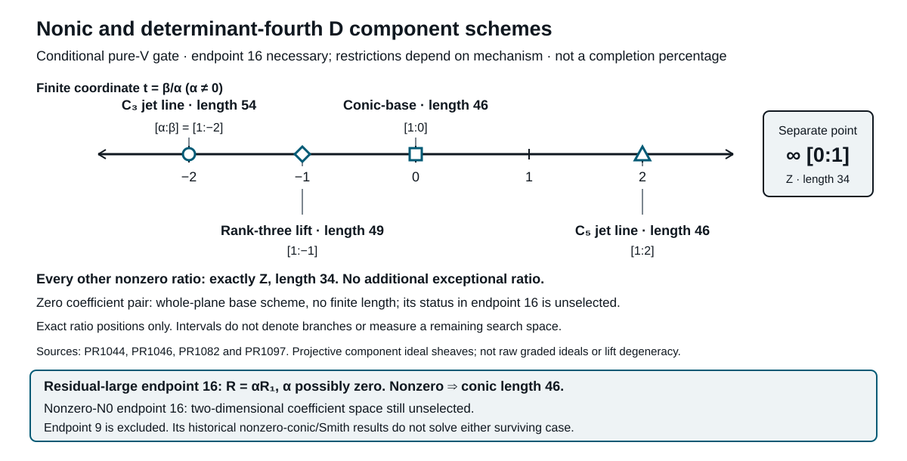

# Proof repair: current status

**Craig Ward · 23 October 2026 · Mathematical checkpoint through PR1061**

**The universal pure-V component-scheme classification is complete, and now transfers to the determinant-embedded original fourth D row. The original proof repair is not.** Four necessary source-dual pairs across three stable labels remain. No actual compatible pure-V source, nonzero gate or coefficient ratio is selected.

[Paper index](paper/README.md) · [Detailed status](paper/01-current-status.md) · [Historical archive](paper/52-root-status-archive-through993.md)

## Complete universal classification

In the pinned quadratic-lift basis R=αR₁+βR₂, every nonzero coefficient pair belongs to exactly one of these five strata. Z denotes the six prescribed length-four order-five ideals (u²,v²) and ten reduced order-three axes, of total length 34.

| Ratio β/α | Complete nonic component scheme | Length |
|---|---|---:|
| −2 | Six Z ideals; m² at ten order-three axes | 54 |
| −1 | Z plus fifteen reduced order-two axes | 49 |
| 0 | Z plus twelve reduced conic points | 46 |
| +2 | m³ at six order-five axes; ten reduced axes | 46 |
| Every other ratio, including infinity [0:1] | Exactly Z | 34 |

This describes the component **ideal sheaf**, equivalently the saturated homogeneous ideal. There are no extra support points, hidden local thicknesses or divisorial components in any nonzero stratum. Equality with Z holds for **every** member outside the four special ratios, not merely a generic member. The two length 46 cases are different schemes, not interchangeable outcomes. [Complete theorem](paper/82-pure-v-complete-nonic-classification.md)

The zero pair is separate: its component ideal is zero and its base scheme is the entire plane, with no finite length. Whether the actual conditional gate is zero remains unknown. The figure locates exact ratios, not mathematical branches between them, fractions of search space or completion percentages.

## New kernel and module structure

On the nonzero C₃ jet line, the nonic kernel is **A O(-3), not V O(-3)**. Its original-fourth kernel has mixed presentation [L,−S] and equivariant extension dimension one, versus ten without equivariance. Uniqueness is only up to scalar/rescaled line injection. [Syzygies](paper/87-pure-v-cubic-a-syzygies.md) · [Presentation](paper/90-pure-v-mixed-presentation.md)

Under compatible pure-V radical, the actual negative module generated by im h starts with **P+D in dimension 9 and W′+2T in dimension 14**. Its generated endpoint now has **dimension 9 or 16**, replacing the earlier eight-value list. Dimension 9 holds exactly when P_h lies in NC2; otherwise its P-generated part is free through quadratic degree. The latter splitting is negative-module only, not Q-stable. Neither branch is selected. [Separated projection](paper/91-pure-v-separated-projection.md) · [Exact dichotomy](paper/92-pure-v-endpoint-dichotomy.md)

The former endpoint-4 formal-lifting antecedent is excluded. This does **not** exclude original generic rank 36 or persistence by another mechanism. The radical acts N0→NC⊂NR and kills NR; no nonzero j4 row on N8 is inferred. These endpoint alternatives are separate from the five nonic coefficient strata.

## Marked subspaces now compared

The canonical quartic D_can maps isomorphically under h to I2, giving the actual decomposition **im Q=ker h⊕D_can**. The generated endpoint F4 is disjoint from D_can in either unselected 9/16 branch. This is not a horizontal splitting or a degree-five descendant statement. [Canonical complement](paper/93-canonical-quartic-homotopy-complement.md)

Separately, mr. slop proves positive joint injectivity and a marked T6 whose negative descendants have both P and D channels nonzero, with coefficient kernel V and bundle quotient V O(2). This selected P+D is in **degree three**, not im h in degree two. [Full-source report](paper/94-positive-mixed-embedding-source-report.md)

## Original-fourth bridge and retained boundaries

The exact bridge proves equality of projective component ideal sheaves for nonic F and determinant-embedded original-fourth D row H=FL, including all ten rank-drop axes. The five-stratum table transfers unchanged. [Exact local comparison](paper/84-pure-v-fourth-ideal-transfer.md)

This is not equality of raw graded ideals, quadratic-lift rank-drop schemes or singular-target fiber maps. Additional specialized A-kernel classes remain outside the comparison. Actual coefficients and source occurrence remain unknown.

## Fixed source frontier

| Source | Stable label | Catalogue pairs (E,Q*) |
|---|---|---|
| Source126 | G3.11.8ae96830fd21 | (10,129), (10,157) |
| Source127 c-d-f | G3.11.cce6e3ba4eeb | (14,148) |
| Source2 | G3.21.d610e381ed75 | (13,21) |

These are **2+1+1 necessary pairs**, not actual realizations. Source126's octic scalar, applicable single-line cubics, c-d-f alternatives, actual compatibility and physical higher lifting/algebraicity remain unresolved. Seven opposite-bundle types are a separate catalogue. [Earlier results and limits](paper/01-current-status.md)

Exact checks support written proofs over pinned premises, not formal certification of the entire repair. Collaborator reports are full-source readings, not independent reproofs. Draft PRs are not merges.
