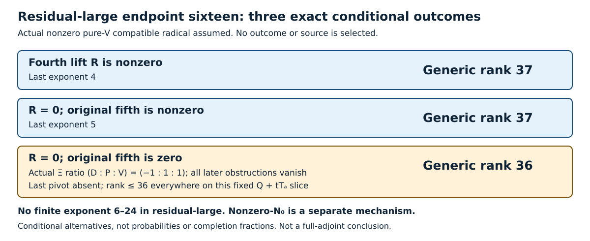

# Proof repair: current status

**Craig Ward · 23 October 2026 · Mathematical checkpoint through PR1115**

**Residual-large now has only three conditional positive outcomes: last exponent4, exponent5 or no remaining pivot. Finite exponents6–24 are excluded in that mechanism.** Actual fourth/fifth values remain unknown. Endpoint nine is excluded; endpoint sixteen has two unselected mechanisms. Four necessary source-dual pairs across three labels remain. This is not full-adjoint invertibility or a complete repair.

[Paper index](paper/README.md) · [Detailed status](paper/01-current-status.md) · [Historical archive](paper/52-root-status-archive-through993.md)

## Complete universal component-scheme classification

For R=αR₁+βR₂, every nonzero pair belongs to exactly one stratum. Z denotes the six prescribed length-four order-five ideals (u²,v²) and ten reduced order-three axes, of total length 34.

| Ratio β/α | Complete nonic component scheme | Length |
|---|---|---:|
| −2 | Six Z ideals; m² at ten order-three axes | 54 |
| −1 | Z plus fifteen reduced order-two axes | 49 |
| 0 | Z plus twelve reduced conic points | 46 |
| +2 | m³ at six order-five axes; ten reduced axes | 46 |
| Every other ratio, including infinity [0:1] | Exactly Z | 34 |

Universal strata need not remain available within each mechanism. The length-46 schemes are distinct. [Complete theorem](paper/82-pure-v-complete-nonic-classification.md)

The zero pair has whole-plane base scheme, with no finite length. Residual-large permits only zero or the conic line; nonzero-N0 still has an unselected two-dimensional coefficient space. No completion percentage follows.

## Residual all-orders theorem and remaining actual gates

[PR1115](paper/130-residual-fifth-and-all-orders.md) proves:

- R≠0: last exponent4, generic Laurent rank37.
- R=0, fifth≠0: exponent5, generic Laurent rank37.
- R=0, fifth=0: all higher obstructions vanish, rank36.

Under R=0, the actual inverse separated-image isomorphism Ξ has three nonzero Schur coordinates. Fifth zero is exactly (D:P:V)=(−1:1:1), the unique alternating bracket line. A fixed canonical-A normalization then constructs polynomial corrections to every order. All maximal minors vanish identically, so rank≤36 everywhere on the fixed Q+tT_a slice, not on all quadratic directions. No actual alignment is selected.

[The common-kernel theorem](paper/127-common-quadratic-homotopy-kernel.md) supplies the forced separated P correction, with residual degree-two kernel17 and full kernel21. These are not the older degree-four kernel16 or horizontal module splittings.

**Residual-large** retains R=αR1. For α≠0 the exact Smith profile is 33 units, three t² and one t⁴ outside the known28-point support. The new generic three-outcome result does not determine every exceptional specialization. Earlier generic5–24 bounds are superseded, not false historical proofs.

**General finite criterion:** [PR1107](paper/126-finite-sequential-obstruction.md) still tests sequential s3,…,s23 at original orders4–24, and remains relevant to nonzero-N0. These are not independent parameters. First nonzero gives rank37; allzero gives rank36 because minor order≥31 exceeds degree30. [The rational checker](paper/128-bounded-certificate-checker.md) verifies supplied identities only; all examples are synthetic, with no actual certificate or geometry authenticated.

**Nonzero-N0:** R=A(R1−4R2)+B(3R1+2R2). For actual row ℓ=(ℓ0,τ) and terminal graph g, zero requires ℓ0+τg=0. Thus τ=0 forces nonzero R; otherwise its zero graph is uniquely −τ⁻¹ℓ0. Neither row nor graph is selected. [Exact channels and corrected factorization](paper/120-corrected-factorization-and-zero-graph.md)

## Two surviving actual negative modules

Both generated modules start with dimensions **9,14,16** in degrees 2–4 and vanish from degree six:

- **Nonzero N0 projection:** degree five has dimension **12**, type 2T; total length **51**. Its terminal subspace may be a graph into NR5. [Separated-terminal theorem](paper/108-separated-terminal-module.md)
- **Zero N0 projection, nonzero N8 projection:** degree five is the marked residual T, dimension **6**; total length **45**. [Residual-large theorem](paper/107-actual-residual-large-module.md)

Both have exact resolutions and annihilator (W)⁴. Neither is the full Rao module or asserted positive-stable.

## Excluded-branch history

Earlier endpoint-nine length-32, nonzero-conic and positive Smith/maximal-row-rank implications have an **excluded antecedent**. They do not solve the surviving positive component. [Dated theorem](paper/106-positive-component-smith-profile.md)

The table classifies projective component ideal sheaves, not raw ideals, lift degeneracy or extra specialized A-kernel classes. [Exact transfer](paper/84-pure-v-fourth-ideal-transfer.md)

[New collaborator source reports](paper/129-positive-contraction-source-reports.md) give an actual marked-incidence transgression detector and constrain positive contraction to at least two effective channels. No detector, opposite row or residual mechanism is selected; these maps are not identified with im h by character.

## Fixed source frontier

| Source | Stable label | Catalogue pairs (E,Q*) |
|---|---|---|
| Source126 | G3.11.8ae96830fd21 | (10,129), (10,157) |
| Source127 c-d-f | G3.11.cce6e3ba4eeb | (14,148) |
| Source2 | G3.21.d610e381ed75 | (13,21) |

These are **2+1+1 necessary pairs**, not actual realizations. Source126's octic scalar, applicable single-line cubics, c-d-f alternatives, actual compatibility and physical higher lifting/algebraicity remain unresolved. Seven opposite-bundle types are a separate catalogue. [Earlier results and limits](paper/01-current-status.md)

Checks support written proofs, not formal certification of the repair. Collaborator reports are source readings, not independent reproofs. Draft PRs are not merges.
