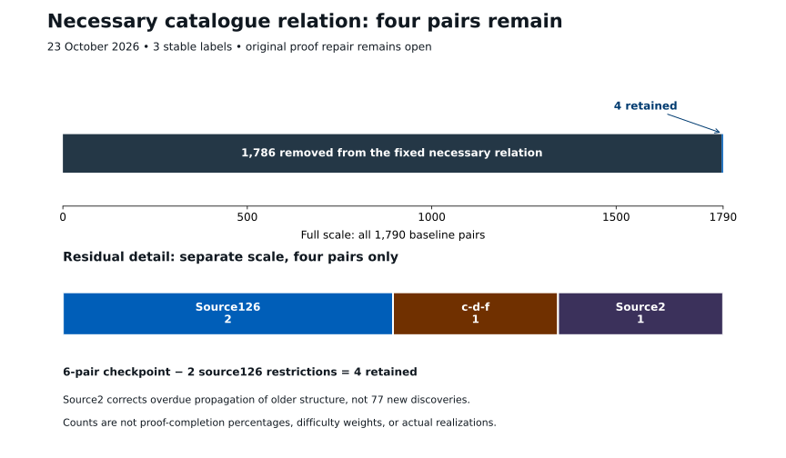
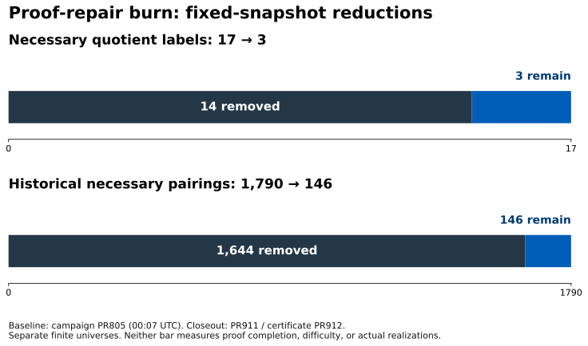

# Current status after the spike burn

This page supersedes earlier current-status summaries, not their dated proofs.

## Current frontier after source126 specialization

**23 October 2026: three stable labels and four necessary catalogue pairs remain, distributed 2 + 1 + 1.** Profiles remain **2 / 0 / 1**. The exact six-pair checkpoint establishes **114 = 77 + 31 + 6**. The subsequent source126 quotient theorem removes two of its four source126 entries, giving **6 = 2 + 4**. No whole label is removed.

| Stable label | Source | Retained catalogue pairs (E, Q*) | Count |
|---|---|---|---:|
| G3.11.8ae96830fd21 | Source126 | (10,129), (10,157) | 2 |
| G3.11.cce6e3ba4eeb | Source127 c-d-f | (14,148) | 1 |
| G3.21.d610e381ed75 | Source2 | (13,21) | 1 |

These numerical indices identify entries in the pinned catalogues, not intrinsic bundle names; the certificates match their mathematical identities and test consistent reindexing.

Three different advances must not be conflated:

- [PR937](https://github.com/Akilleez-QA/read-em-and-weep/blob/359475bea8dced5a6b12cc008f18bd81588fce41/research/hm/source2-bundle-specialization/PROOF.md) corrects overdue propagation of already established source2 structure into an overinclusive ledger: **78 → 1**. Its 77 removed pairs are not 77 new geometric discoveries.
- [PR939](https://github.com/Akilleez-QA/read-em-and-weep/blob/9c43c9b3bb9cb99c809c37a8fe8f8429f4b3a79e/research/hm/cdf-quotient-specialization/PROOF.md) proves a new quotient-bundle corollary of the c-d-f normal form: **32 → 1**. Its 31 removed pairs come from the forced equivariant quotient, without claiming a horizontal or constant lift splitting.
- [PR941](https://github.com/Akilleez-QA/read-em-and-weep/blob/c14af3d39881197edd781aa06cb1e918ef8fd42a/research/hm/source126-dual-specialization/PROOF.md) proves a new source126 quotient specialization: **4 → 2**. Residual Types I and II force Q*129; Type III forces Q*157. The abstract template families do not identify an authenticated fixed HM realization.

The original proof repair remains open. Four is a count in a fixed necessary relation, not four actual realizations, four equally difficult tasks, a proof-completion percentage, or a measure of all possible proofs. Actual source compatibility, physical construction and higher lifting/algebraicity remain unresolved.

See the [new source126 specialization](36-source126-dual-specialization.md) and [six-pair checkpoint addendum](35-six-pair-specialization.md) for bundle identities, exact evidence and recent collaborator results. The historical 146-pair burn endpoint below remains unchanged.

## Historical burn closeout

The burn produced substantial structural pruning and several new construction interfaces, but **not a complete repair**. At the PR911 burn cutoff, the reconciled written-proof frontier had **three necessary quotient labels**, profiles **2 / 0 / 1**, and **146 historical necessary paired witnesses**. The source-recovery, higher-lifting and algebraicity objectives remain unresolved.

| Fixed quantity | Campaign baseline | Closeout | Change |
|---|---:|---:|---:|
| Necessary quotient labels | 17 | 3 | 14 excluded |
| Restricted historical necessary pairs | 1,790 | 146 | 1,644 removed |
| Indexed profile counts (11 / 12 / 21) | 16 / 0 / 1 | 2 / 0 / 1 | Separate profiles retained |

The baseline is the immutable 00:07 UTC snapshot in [PR805](https://github.com/Akilleez-QA/read-em-and-weep/pull/805), not the number of live jobs at startup. The final [certificate in PR912](https://github.com/Akilleez-QA/read-em-and-weep/pull/912) separates source cuts from whole-label exhaustion and passes **339 cumulative regression tests**. These are accounting/scope tests, not formal proofs of all geometric dependencies. The reductions are approximately **82.4% of the baseline labels** and **91.8% of its paired relation**. Neither is a proof-completion percentage, probability of success, difficulty estimate, or count of actual realizations.

## What remained at the burn cutoff

| Stable label | Original source index | Remaining source types | Necessary pairs |
|---|---:|---|---:|
| G3.11.8ae96830fd21 | 126 | E10: (0,0,0,0,0,1,1,0) | 4 |
| G3.11.cce6e3ba4eeb | 127 | c-d-f and a-b-c-f | 64 |
| G3.21.d610e381ed75 | source2 | Thirteen original tuples | 78 |

Nonempty abstract families exist for the degree-28 branch and source127 c-d-f. They show that the already imposed abstract conditions alone cannot eliminate those cases; they do **not** identify an actual HM realization. See [PR869](https://github.com/Akilleez-QA/read-em-and-weep/pull/869), [PR876](https://github.com/Akilleez-QA/read-em-and-weep/pull/876), and the [exact residual record](../research/proof-repair-campaign/FRONTIER-THROUGH911.md).

The last established section-count conclusion remains four or five sections on a general smooth inversion-even quadric, with no odd sections. This burn did not evaluate the decisive fourth/higher boundary or turn the three surviving labels into an actual solution.

## The construction advance

The new chain separates tasks that were previously easy to conflate:

1. [PR816](https://github.com/Akilleez-QA/read-em-and-weep/pull/816): exact typed nonclosed frame-transfer defect, retaining both homotopy terms.
2. [PR866](https://github.com/Akilleez-QA/read-em-and-weep/pull/866): mixing independently normalized lower projection and source row introduces a precise scalar error. Abstract gluing alone leaves a thirteen-dimensional trace ambiguity.
3. [PR889](https://github.com/Akilleez-QA/read-em-and-weep/pull/889): with separately authenticated coherent symmetry and polynomial-family hypotheses, the calibration problem has ten family parameters and a two-family separating test. The varying source multiplier is retained.
4. [PR894](https://github.com/Akilleez-QA/read-em-and-weep/pull/894): a supplied compatible source must pass a sharp 27-slot cohomology condition after canonical correction. Smaller trace tests do not certify membership. [PR903](https://github.com/Akilleez-QA/read-em-and-weep/pull/903) extends that limitation to regular algebraic nonlinear zero-tests.
5. [PR904](https://github.com/Akilleez-QA/read-em-and-weep/pull/904): all seven compatible W-family directions leave the physical response unchanged on the stated fourth-neighborhood calculation. This does not extend to ambient or fifth-order norm equality.
6. [PR908](https://github.com/Akilleez-QA/read-em-and-weep/pull/908): solve the canonical source on the global cone, lift, then recover a closed compatible W rather than guessing it first. The actual physical row and full ambient lower projection still have to be constructed and matched.
7. [PR909](https://github.com/Akilleez-QA/read-em-and-weep/pull/909): for the additionally authenticated full-cover, regular, all-twist-compatible subclass, a realized normalization defect is divisible by the negative quadratic and gluing forces it to vanish. This does not erase the unrestricted abstract thirteen-space or supply the missing physical hypotheses.

These are independently reviewed written deductions over pinned premises. Their bounded Python diagnostics are supporting checks, not Lean certification.

## Formalization and execution evidence

The burn published **13 focused draft Lean packages with 66 distinct checked supporting declarations**, using Lean 4.34.1 and pinned mathlib. Publication evidence records successful compilation and separate importing axiom checks; the audited closures list only propext, Classical.choice and Quot.sound. Four dependency rechecks are not counted as new declarations. The source/receipt audit is not a second independent kernel run.

These packages formalize conditional algebra, frame transfer, trace coordinates, tensor/projector compatibility, source-dependent polynomial observation, and cyclic support. They do not formalize the whole geometric exclusion chain, construct the actual HM tensors/physical rows, or prove the original theorem.

The earlier Python runtime track completed bounded initialization and one primitive-CG global unit. It did **not** complete the full 65-map q65 aggregate. Partial legacy logs remain partial. Resource receipts distinguish sampled process-group RSS from a hard address-space bound. No total cost, energy use or aggregate CPU figure is inferred from selected receipts.

See the [root status paper](../README.md) and [full closeout](31-spike-burn-closeout.md).
