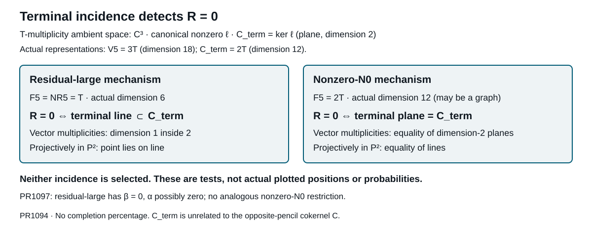

# The symmetric lift vanishes exactly at an actual terminal incidence

**23 October 2026 update:** PR1101 refines the separated test: τ=0 forces R≠0; if τ≠0, zero requires the unique actual graph g=−τ⁻¹ℓ0. Neither incidence is selected.

**23 October 2026 · PR1094, read in full**

[Immutable proof](https://github.com/Akilleez-QA/read-em-and-weep/blob/79b84d3b21cdbc76bb19d3a973e09981936dda32/research/hm/source2-pure-v-terminal-transfer-incidence/PROOF.md), blob `dd21bc9302ea9ffcd84dddf72ce7a676c326600d`.

**PR1097 refinement:** [Residual-large now forces β=0](118-residual-large-conic-gate.md), with α possibly zero. Neither terminal incidence is selected; the nonzero-N0 coefficient space remains unrestricted by that theorem.

## A canonical terminal kernel, not a chosen plane

Under actual source2 nonzero pure-V compatible-radical hypotheses, let J3=ker j3, K3=ker Q3∩ker j3 and V5=im Q3=(M5)_T≅3T. There is a canonical nonzero equivariant map ℓ:V5→I3=T. Write **C_term=ker ℓ** here to distinguish this kernel from the unrelated opposite-pencil cokernel C. The theorem's notation C means this C_term. It has character 2T and actual vector-space dimension twelve.

On T multiplicity spaces, ℓ is a nonzero functional C³→C and C_term corresponds to a canonical two-dimensional plane. Its projectivization is a line in P². The quadratic fourth lift satisfies

    R=0 ⇔ ℓ(F5)=0.

The two surviving mechanisms therefore have different exact tests:

- Residual-large: F5=NR5=T is the actual marked residual space. Vanishing is equivalent to NR5⊂C_term. On multiplicities this is a line contained in a plane; projectively, a point on a line.
- Nonzero-N0 projection: F5≅2T and vanishing is equivalent to **F5=C_term as embedded subspaces**. On multiplicities this is equality of planes; projectively, equality of lines. F5 may be a graph into NR5 and cannot be replaced by its separated projection.

Neither incidence is selected. R may still vanish, and neither mechanism is excluded or asserted realized.

## Factorization through the actual odd quadratic

The actual map θ:J3→I3 is θ(z)=X_x hY_yz−X_y hY_xz. It kills K3: the entire T-isotypical part of K3 lies in F3, which each hY_n annihilates, while equivariance kills the other constituents. The restriction Q3:J3→V5 is onto because j3(ker Q3)=I3 permits correcting any lift into J3. Hence θ factors uniquely as ℓQ3 on J3.

This is a canonical actual-map factorization, independent of an equivariant section of Q2. Since θ(NR3)=I3, ℓ is nonzero and onto. The full middle pairing also gives the embedded equality

    C_term=Q3(ker A_h).

Indeed ker A_h has dimension 38 and its intersection with ker Q3 has dimension 26, leaving an actual twelve-dimensional image contained in C_term. This is not an identification from equal characters alone.

## Why terminal vanishing detects the entire symmetric lift

For an equivariant section G of Q2 and inverse s:I4→P_h, set k_b=G T_b s. The actual cubic comparison is

    ℓ((lb)s(p))=X_x B(yl,b)p−X_y B(xl,b)p.

B is symmetric by PR1089. Its trivial multiplication-kernel channel vanishes because Hom_G(P,D)=0, so it factors through A4:Sym⁴W⊗I4→I2. In coherent polynomial coordinates A4(f,p)=i2(U_p(f)), the comparison becomes

    ℓ(c s(p))=i3[x U_p(yc)−y U_p(xc)].

The universal operator D(U)(c)=xU(yc)−yU(xc) maps End(Sym⁴W) onto Hom(Sym³W,Sym⁵W), with rank 24 and kernel exactly the scalar identity. The recurrence xU(e_(i+1))=yU(e_i), together with polynomial divisibility, proves this kernel exactly. Since Hom_G(P,1)=0, the scalar kernel disappears on the equivariant P-family. The resulting map between the two-dimensional channel spaces is an isomorphism.

All F5 is generated by cubic P_h descendants; cubic I2 descendants vanish because W I4=0. Thus ℓ(F5)=0 iff the full symmetric B vanishes, iff its diagonal R vanishes. This proves both directions, retaining the canonical plus sign of the transfer and the minus sign of the Koszul determinant.

## Limits

This theorem translates the remaining gate into actual incidence; it does not decide it, identify any terminal graph, evaluate a source coefficient, or supply positive/full-adjoint ranks. Endpoint sixteen and four necessary source pairs remain. C_term is not the opposite cokernel C, and its multiplicity-plane dimension two is not its actual vector-space dimension twelve. The universal rank-24 certificate is not an instance rank or a completion fraction.
