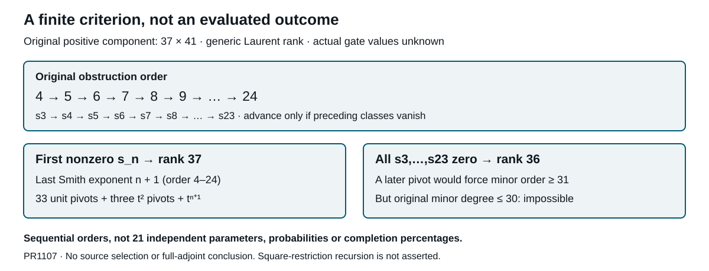

# A finite sequential criterion for the original positive component

**Later refinement, 23 October 2026 (PR1115):** In residual-large only, the generic remaining exponent is now exactly4,5 or absent. If R and the original fifth both vanish, all higher classes vanish and generic rank is36; finite6–24 are excluded. Actual alignment is unselected. Earlier generic residual ranges here are dated bounds, not the current list. The general criterion and nonzero-N0 bounds remain valid; exceptional-direction claims with globally nonzero R are not strengthened by this generic classification. See [chapter130](130-residual-fifth-and-all-orders.md).

**23 October 2026 · PR1107, full immutable proof read**

[Immutable proof](https://github.com/Akilleez-QA/read-em-and-weep/blob/5b52eedce3420ccc3e407e97201bcdd056501bbf/research/hm/source2-pure-v-finite-obstruction/PROOF.md), blob `a8f57401d93c296d23a5ed55cd09d8893222e7c1`.

## Exact finite stopping rule

Under actual source2 nonzero pure-V compatible-radical hypotheses, the original positive 37-by-41 component has generic Laurent rank **37 iff** the sequential process finds a nonzero class among s3,…,s23, corresponding to original orders **4,…,24**. If the first nonzero class is s_n, its last Smith exponent is n+1, alongside 33 units and three t² pivots.

If all these classes vanish, the generic rank is **36**, with kernel dimension five. This is not an assumption of automatic higher vanishing: a finite remaining pivot would have exponent at least25, forcing maximal-minor order at least31, while every original maximal minor has polynomial degree at most30. Thus all maximal minors are identically zero; the known 36 pivots retain rank36.

The criterion is proved but **not evaluated on actual source data**. It does not select the rank, any gate value, a source or a mechanism, and is not a full-adjoint criterion.

## Canonical global recursion

Conditional on all preceding classes being zero, each quotient order-n obstruction is the actual canonical sheaf map

    s_n:P O(−n) → J=I_Z(6),    n≥3,
    iota β_(n+1)|D=−s_n L.

Generic surjectivity of L and torsion-freeness of J make original and quotient vanishing equivalent. Sheaf pages do not purport to exhaust specialized extra A kernels at second-rank-drop points.

Fix actual polynomial correction strings x0=s and qx_i=−T x_(i−1). Their raw lift is C_n=j2x_(n−1), and s_n=[LC_n]. The canonical class is independent of correction choices modulo earlier vanishing symbols and the second-page target image. Its existence is not an arbitrary choice from an equivariant Hom space.

If s_n=0, the injective J resolution gives the unique global decomposition

    C_n=m g_n+κ c_n,
    deg g_n=n−2,    deg c_n=n−5.

For the actual canonical A inclusion a_A, let u_A=−G T a_A. The two identities qu_A=−T a_A and j2u_A=−μm, with μ≠0, permit a simultaneous update:

    x'_(n−2)=x_(n−2)+a_A g_n/μ,
    x'_(n−1)=x_(n−1)+u_A g_n/μ.

Both earlier equations remain valid and j2x'_(n−1)=κc_n. The κ remainder is retained, not silently discarded; Lκ=0 makes the next q equation soluble. A fixed equivariant inverse constructs x_n globally with no direction-dependent denominators. This proves continuation at every order, including the first κ degree.

## Sequential target dimensions, not independent parameters

The lift/m-gauge/κ-gauge/target dimensions begin as follows:

| Quotient order n | Original order n+1 | Lift | m gauge | κ gauge | Target |
|---:|---:|---:|---:|---:|---:|
| 3 | 4 | 2 | 0 | 0 | 2 |
| 4 | 5 | 3 | 1 | 0 | 2 |
| 5 | 6 | 5 | 2 | 0 | 3 |
| 6 | 7 | 7 | 3 | 0 | 4 |
| 7 | 8 | 9 | 4 | 0 | 5 |
| 8 | 9 | 12 | 5 | 1 | 6 |

The original sixth therefore has a genuine three-dimensional target after the earlier classes vanish. The first equivariant κ gauge is at quotient order8, original order9. The full pinned gate table computes all stages through s23 using plane-coordinate symmetric powers of A, not binary powers of W.

These are conditional sequential target dimensions, **not twenty-one independent parameters**, realized gate choices, source moduli, probabilities or completion measures. The whole-plane recursion is not asserted to commute with restriction to the square conic; the sharper square degree bound remains a separate result.

## The finite certificate and remaining task

In the all-zero outcome, the global corrections x0,…,x23 form a finite coefficient certificate. The truncated original vector d−Σ_(i=0)^23 t^(i+1)x_i(Ld) has image −t²⁵T x23(Ld), so orders through24 cancel. Once actual q,T,s are supplied, these are finite polynomial coefficient equations linear in the unknown corrections. No such actual coefficient data is evaluated here.

Conversely rank36 forces all sequential classes to vanish generically and hence globally, and the recursion constructs these strings. The finite test is therefore an equivalence, not merely a sufficient truncation. Four necessary source pairs and both endpoint-sixteen mechanisms remain. This result gives a finite task for the original positive block, not an executed source-occurrence test or completed proof repair.
