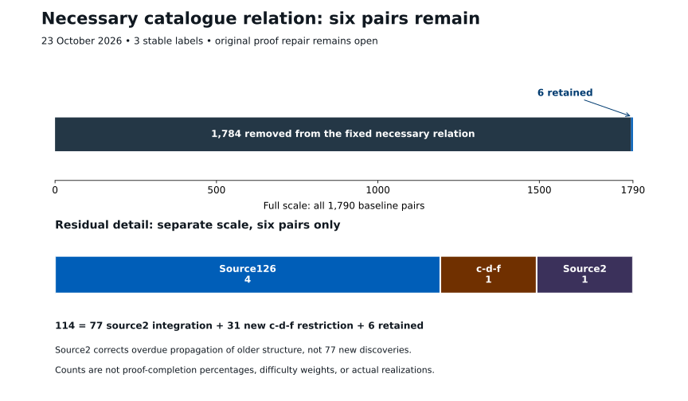

# Six-pair specialization of the necessary relation

**Craig Ward · 23 October 2026 · Addendum after PR937 and PR939**

**Historical checkpoint:** the subsequent [source126 specialization](36-source126-dual-specialization.md) reduces six to four. This addendum preserves the six-pair proof and composition without rewriting its endpoint.

## Exact result and its scope

The previously published 114-pair relation now specializes to **six pairs across the same three labels**. The checks establish a disjoint partition, not merely a subtraction of reported totals:

    114 = 77 source2 mismatches + 31 c-d-f mismatches + 6 retained pairs.
    6 = 4 source126 + 1 source127 c-d-f + 1 source2.

The profiles remain 2 / 0 / 1. Source126 retains E10 with Q* catalogue indices 129, 157, 231 and 249; c-d-f retains (14,148); source2 retains (13,21). Catalogue indices are local identifiers. The filters derive these identities from exact bundle multisets and source tuples and remain valid under consistent catalogue reindexing.

This is a restriction of a fixed necessary relation. It does not establish occurrence, exclude any of the three stable labels, or settle the original proof repair.

## Source2 is an overdue integration correction

[PR937 at its immutable commit](https://github.com/Akilleez-QA/read-em-and-weep/blob/359475bea8dced5a6b12cc008f18bd81588fce41/research/hm/source2-bundle-specialization/PROOF.md) imports the previously proved source2 structural results, including PR751 and PR758/790/795. They force

    E = W O(-9) + T O(-3) + (P+D) O(-2),
    Q* = (P+D) O(-2) + A O(-6) + O(-18).

The coefficient tuple is (0,1,0,0,0,0,1,0). The associated catalogue entry is (13,21). Of the old 78 entries, 72 have the wrong E and five more have the wrong Q*. All balanced endpoints and both residual coupling classes are covered.

The relevant extension groups vanish because H1(O(1)) and H1(O(12)) vanish; finite-group averaging makes the bundle splittings equivariant. This does not give a horizontal splitting or remove residual constant-coordinate coupling. The historical ledger had not incorporated these established constraints. Thus the **78 → 1** change is a substantive accounting repair, not 77 newly proved geometric exclusions. The package has 21 tests in both ordinary and optimized Python modes.

## The new c-d-f quotient corollary

[PR939 at its immutable commit](https://github.com/Akilleez-QA/read-em-and-weep/blob/9c43c9b3bb9cb99c809c37a8fe8f8429f4b3a79e/research/hm/cdf-quotient-specialization/PROOF.md) applies the universal apolar annihilator calculation to the actual tower of the pinned c-d-f normal form. It yields

    0 → O(18) → Q → S O(7) + Sym^7(W) O(1) → 0.

The extension group is H1(S O(11)) + H1(Sym^7(W) O(17)), hence zero. After equivariant splitting and dualizing,

    Q* = O(-18) + S O(-7) + W' O(-1) + T O(-1).

The source tuple (0,0,1,1,0,1,0,0) has E = (P+D) O(-2) + (V+P) O(-4) + O(-8). The forced semantic pair is (14,148), leaving **one of the 32** c-d-f entries. The result is independent of the retained off-diagonal lifts; it does not assert those lifts vanish. The package records 351 symbolic/identity checks and ten negative controls in both Python modes. These support the written argument; they do not formalize its geometric dependencies.

## Exact composition evidence

The [composed certificate in PR940](https://github.com/Akilleez-QA/read-em-and-weep/blob/7e3a97c554da608360f6bd96ac4606e970741378/research/proof-repair-campaign/six-pair-composition/README.md) authenticates the [exact frontier](https://github.com/Akilleez-QA/read-em-and-weep/blob/7e3a97c554da608360f6bd96ac4606e970741378/research/proof-repair-campaign/six-pair-composition/frontier.json). Its SHA256 is

    9042fa6453037f77b0bff5765e04a92b4f596c85575f4f7d63866db5aa6d8677

Its integration verifier authenticates the pinned 114-pair checkpoint and the two specialization outputs, proves their cuts are label-disjoint, preserves every unrelated pair, and tests consistent catalogue reindexing. It rejects duplicated, missing, mis-scoped and double-applied cuts. **18 integration tests pass in ordinary and optimized Python modes**, with both prerequisite checkers separately replayed. This is a reproducible composition certificate, not a further geometric exclusion theorem. The previous published checkpoint is [PR919](https://github.com/Akilleez-QA/read-em-and-weep/pull/919).

## Recent collaborator results do not remove another label

[PR935's complete pinned proof](https://github.com/Akilleez-QA/read-em-and-weep/blob/a7707ba3e25592023eb69cc15686aa4ee1fdcb7c/research/hm/profile11-source127-cdf-bockstein-rigidity/PROOF.md) proves that, conditional on an actual c-d-f occurrence, the fixed negative-pencil algebra compatible with the single invariant product is scalar. A hypothetical remaining invariant block would be surjective for Q and stable under every negative quadratic; formal kernel lifting would then force the actual second Bockstein to vanish on its unique A summand, contradicting the imported nonvanishing theorem. Both nonscalar idempotent types are excluded. **Scalar compatibility is consistent with c-d-f occurrence**. This resolves the former residual idempotent question, not source realization or a source-dual pair.

[PR936's complete pinned proof](https://github.com/Akilleez-QA/read-em-and-weep/blob/60fd2b9951dd151dfbdff5b09316d05495cca53d/research/hm/opposite-torsion-trichotomy/PROOF.md) restricts the opposite-pencil torsion length to **0, 12 or 24**. Complete evaluation isolates a canonical square torsion subpencil, with a noncanonical equivariant complement. At length 24 there are three necessary global character patterns and six quotient-bundle possibilities. In the middle pattern, the actual cotangent character rules out cyclic length-two stalks: each stalk is k². The associated vertex-ideal extension then retains torsion of length 12 or 24. **No actual torsion length, maximal pattern or extension class is selected**, and no source/frontier count changes.

These are authored written proofs with pinned dependencies and recorded review, not proof-assistant verification of the entire argument. Their statements and limitations are taken from the full proof texts, not inferred from PR counts or titles.

## What remains

Source126's four pairs require further structural discrimination. [PR922](https://github.com/Akilleez-QA/read-em-and-weep/blob/92367464591420320cc0b84c05207e87f576cc9c/research/hm/source126-radical-rank/PROOF.md) gives a represented-radical fingerprint and exceptional-direction bounds, but no cut is counted here. The unique remaining c-d-f and source2 bundle pairs still require actual-source compatibility. The global-cone fixed-minor interface of PR918 does not supply the missing actual differential, physical extraction, marking or ambient normalization. Decisive higher-boundary evaluation, higher lifting, source recovery and algebraicity remain unresolved.

The historical burn endpoint remains 146 pairs at PR911. The subsequent checkpoints are 114 after PR917, 37 after source2 integration, and six after c-d-f specialization. Relative to the fixed 1,790-pair campaign baseline, 1,784 entries have been removed; the three-label count remains unchanged since the burn closeout. None of these quantities measures remaining proof difficulty or completion.
