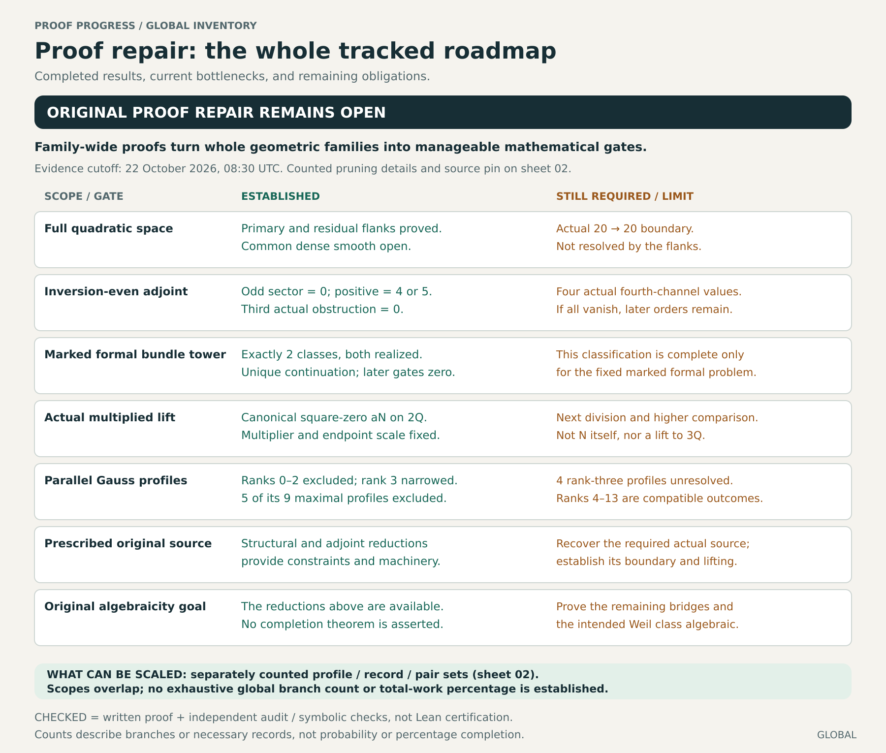
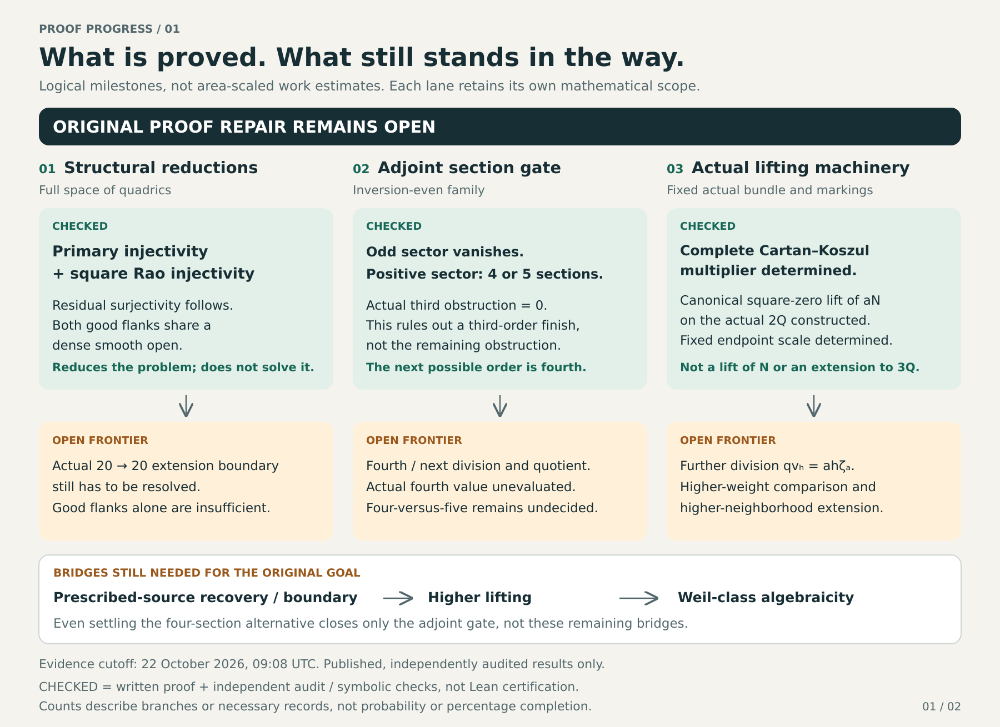
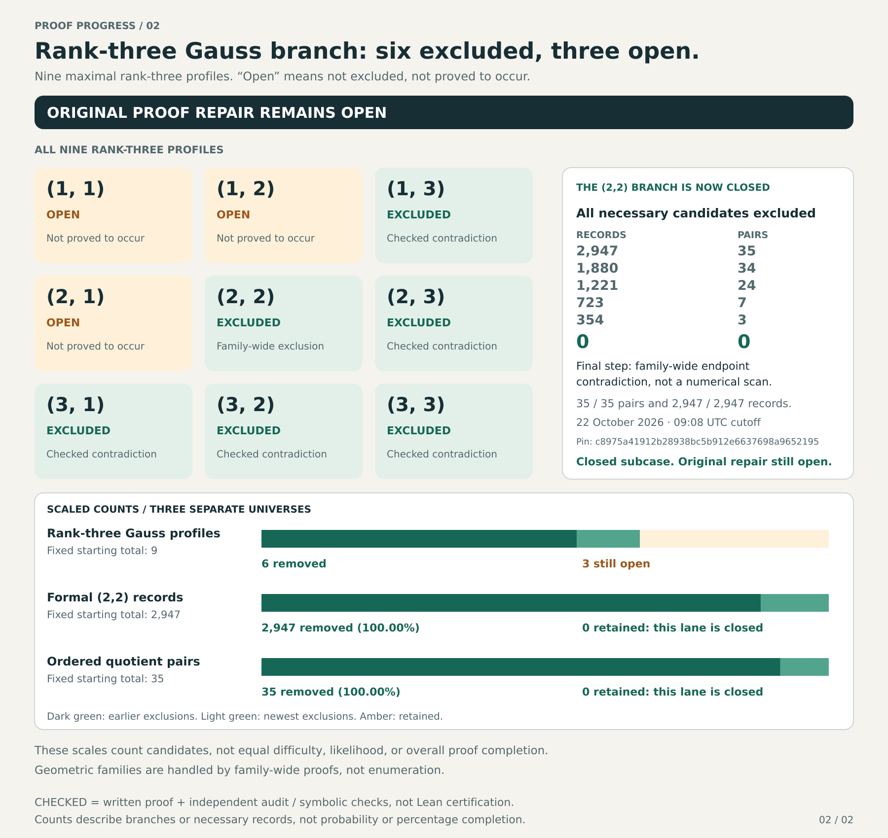
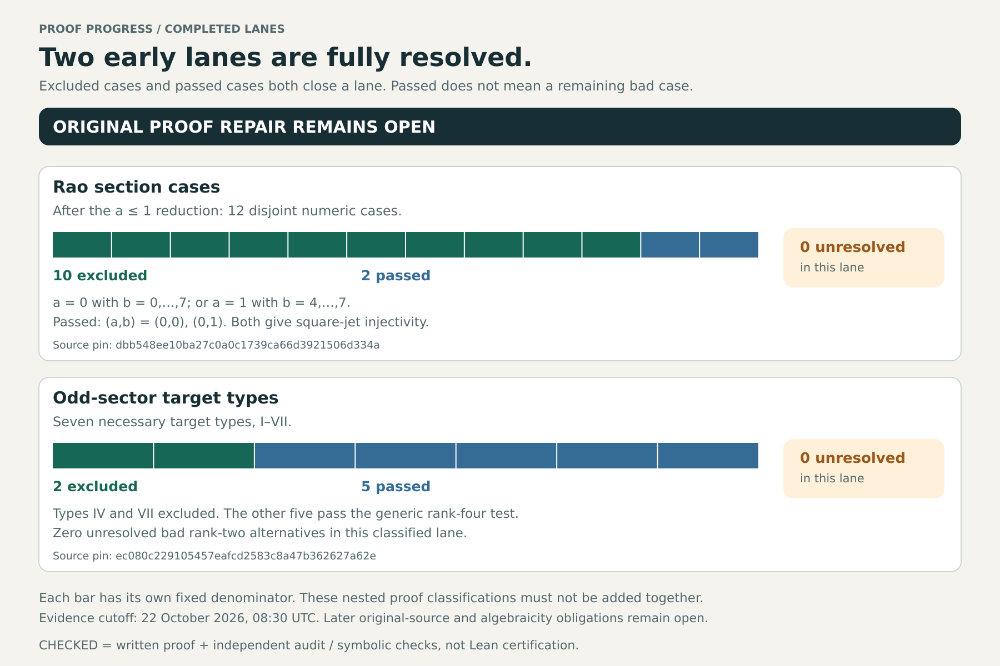

# Proof progress map

**Published-source cutoff: 22 October 2026, 09:08 UTC.** These four panels distinguish established prerequisites, excluded possibilities and remaining obligations across the original proof-repair program. The fourth value and the original source, higher-lifting and algebraicity bridges remain open.

There is no proved project-wide partition into disjoint geometric families, and no overall completion percentage. The whole-project panel groups overlapping scopes. Roadmap boxes are logical milestones, not scaled estimates of difficulty, time or probability. The inventory's eight named core objectives (three proved prerequisites and five open obligations) are an editorial ledger, not a natural geometric count. The full-space and inversion-even routes must not be silently identified.

## Whole-project inventory

The seven grouped rows are not seven independent obligations. Family-wide theorems handle infinitely many instances; finite pruning counts do not measure the remaining difficulty of those families.

## Proof roadmap

The actual third gate is zero, closing a third-order finish, not the proof. The explicit multiplied aN lift is on actual 2Q, not a global lift of N. Chapter 24 supplies an exact actual 5Q boundary comparison. Chapter 25 proves the existing corrected J3 square-zero on actual 3Q, but does not evaluate the boundary or its primitive, or extend the midpoint bundle.

## Rank-three Gauss pruning, at fixed denominators

Each bar preserves its own initial denominator. Within rank three, six of nine maximal profiles are excluded and three remain possible: (1,1), (1,2), and (2,1). The entire (2,2) profile is excluded. Its ordered-pair history is 35→34→24→7→3→0 and its formal-record history is 2,947→1,880→1,221→723→354→0. Thus all 35 baseline pairs and all 2,947 baseline records are excluded. The final step is a family-wide endpoint contradiction, not a numerical rank scan or a realization test. These nested counts must not be added together. SF≥3 and square rank≥27 remain unchanged.

The broader Gauss rank universe is separate: ranks zero through two are excluded, rank three has this nine-profile refinement, and ranks four through thirteen are compatible, goal-satisfying outcomes, not ten additional obstacles. Neither the nine profiles nor the formal records exhaust the original project.

## Completed early lanes

Dark green denotes excluded cases; blue denotes cases for which the required conclusion is proved; amber denotes unresolved candidates. Rao has twelve disjoint numerical cases after a≤1: ten excluded and two passed, with no unresolved bad case. The odd lane has seven target types: two excluded and five passed, again with no unresolved bad case. Passed cases need not be realized geometries. Their nested carrier or bad-rank subdivisions are not extra additive cases.

## Sources and machine-readable inventory

- [Full scoped inventory and immutable sources](data/INVENTORY.md).
- [Machine-readable inventory](data/inventory.json): 27 scoped universes, stable IDs, parent relationships, status, scope, exhaustiveness and overlap rules. Chapter hashes record the source snapshot used for the inventory, not a claim to hash this later edition.
- [Reproducible inventory validator](data/validate_inventory.py): run `python3 paper/data/validate_inventory.py` from the repository root. It checks each local denominator, weighted status counts, nested copies, record histories and the editorial ledger without adding universes together. Global totals remain null.
- [Chapter 25: complete (2,2) closure and actual J3 square-zero](25-complete-two-two-exclusion-and-actual-third-neighborhood-square.md).
- [Visual quantitative data](data/visual-quantitative-data.json), retaining fixed denominators and the complete histories.
- [Chapter 7: primary and Rao reductions](07-primary-and-rao-reductions.md); [Chapter 3: odd closure](03-odd-sector.md); [Chapter 6: dependency ledger](06-dependencies-and-changelog.md).

The SVGs retain editable text. The images summarize checked published sources, not a fresh independent recertification of every proof or a proof-assistant certificate. Separate V51 comparison work is not included in original-repair totals. Counts are local to their named universes; no area or fraction is a percentage proof completion.
